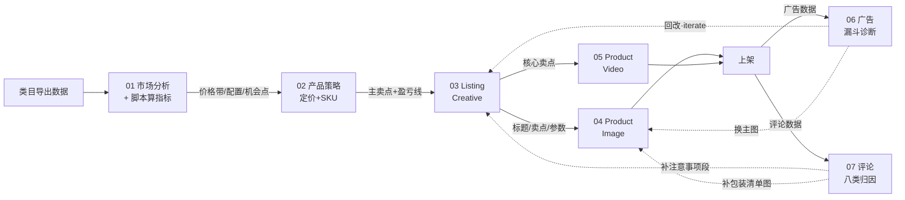

# AI Cross Border Ecommerce Agent Toolkit

**AI 跨境电商运营智能体工具箱** · *Turn cross-border ecommerce SOPs into reusable AI Agent workflows.*

[](./LICENSE)
[](./CHANGELOG.md)
[](#-agent-全景)

---

## 这是什么

把**跨境运营 SOP 里沉淀的经验**，翻译成**可复制的 AI Agent 工作流**：一个标准 Prompt + 一份输入模板 + 一个真实案例，任何人都能拿去直接跑出可发布的商品素材。

不是软件，不是 SaaS，只做四件事：

| 交付物 | 说明 |
|---|---|
| 📘 运营方法论 | SOP 章节 → Agent 模块的完整拆解表 |
| 🧠 AI Prompt | 角色 / 任务 / 输入契约 / 输出契约 / 自检 |
| 🔁 工作流程 | 什么顺序跑、什么条件进入下一步、什么条件回流重改 |
| 📄 模板 + 案例 | 标准输入格式 + 真实产品的完整跑通记录（含复测数据） |

> **v0.6–v0.29 新增可选层**：`runtime/`（Agent Runtime 平台核心）——7 个 Agent 的能力卡、意图路由、任务切片、审批信封、证据链、工具桥接，以及可跨进程跑通 7 Agent 全链路的 SQLite 编排引擎。
> 它**不改变工具箱的用法**：不装运行时也能继续"三个文件跑通"；只有准备升级成多智能体系统时才需要它。
> 见 [`runtime/README.md`](./runtime/README.md) 与 [`docs/06_Agent_Runtime_Integration.md`](./docs/06_Agent_Runtime_Integration.md)。

**为什么做这个**：跨境运营的难点不是"不知道要做什么"，而是"知道但做不出稳定下限的产出"。同一个类目，老手写标题一次到位，新人写十遍还是堆词。这套工具箱的目标是把老手的**判断规则**结构化，让 AI 的产出稳定在老手水平线上。

---

## 📎 原始资料来源

本仓库的方法论拆解自一份 38 页的内部运营手册，原文已随仓库提供：

📄 **[《Shopee 巴西站运营 SOP 总框架》（PDF · 38 页 · 29.7 MB）](./docs/电商运营SOP总框架.pdf)**

SOP 章节与 Agent 模块的逐条对应关系见 [`docs/00_Architecture_SOP_to_Agent.md`](./docs/00_Architecture_SOP_to_Agent.md)。

> ⚠️ **请注意**：这份 PDF 是**未经删改的原始内部手册**，其中包含平台明确禁止的做法（如刷单、诱导评价、虚假举报、参数虚标等）。
>
> **本仓库的 7 个 Agent 模块均未实现这些做法**：已识别项及其合规替代方案见 [`docs/03_Compliance_Guard.md`](./docs/03_Compliance_Guard.md)，未实现项逐条登记见 [`docs/05_SOP_Gap_Register.md`](./docs/05_SOP_Gap_Register.md)。
>
> 换句话说 —— **这份 PDF 是「原料」，不是「产品」。** 本仓库的产出物只包含合规路径。

---

## 🗂 Agent 全景

7 个模块，**全部已完成**。

| # | Agent | 中文 | 一句话职责 | 版本 |
|---|---|---|---|---|
| **01** | [Market Research Agent](./Agents/01_Market_Research_Agent/) | 市场分析 | 前置判断 / 容量 / 集中度 / 价格带（波谷检测）/ 配置组合 · **带计算脚本** | ✅ v0.4 |
| **02** | [Product Strategy Agent](./Agents/02_Product_Strategy_Agent/) | 产品策略 | 定位 / 配置 / 主推卖点收敛 / 定价模型 / SKU 四角色 · **净利率/盈亏价/券余量矩阵** · Skill 化 | ✅ v0.4 |
| 03 | [Listing Creative Agent](./Agents/03_Listing_Creative_Agent/) | 商品内容生成 | 关键词分类 → 标题 → 详情页 → 卖点/参数 · **字符实测/参数溯源校验** · Skill 化 | ✅ v0.4 |
| 04 | [Product Image Agent](./Agents/04_Product_Image_Agent/) | 主图与详情图 | 9 图规划 → Campaign Style Lock → 出图 Prompt → **可选批量渲染 + 像素级合规校验** · Skill 化 | ✅ v0.5 |
| 05 | [Product Video Agent](./Agents/05_Product_Video_Agent/) | 短视频生成 | 脚本 → 分镜 → AI 视频 Prompt → 配音字幕 | ✅ v0.4 |
| 06 | [Advertising Optimization Agent](./Agents/06_Advertising_Optimization_Agent/) | 广告优化 | 四类漏斗诊断 + 盈亏线核算 + **P0/P1/P2 分级动作** · Skill 化 | ✅ v0.4 |
| 07 | [Review Analysis Agent](./Agents/07_Review_Analysis_Agent/) | 评论分析 | 八类归因 + 误解型识别 → 详情页修补建议 | ✅ v0.4 |

> **这七个模块构成一条完整链路，而且是闭环的**：
>
> ```text
> 01 市场分析 ──► 02 产品策略 ──► 03/04/05 素材产出 ──► 上架
> （做什么）      （做成什么样）    （怎么表达）
>                                                      │
>                          ┌───────────────────────────┘
>                          ▼
>              06 广告诊断 ─┐
>              07 评论诊断 ─┴──► 回流 03/04 修正 ──► 复测 ──► 达标放量 / 未达标回诊断
> ```
>
> **为什么按这个顺序编号**：`01-02` 分析簇（前置链路）→ `03-04-05` 创意簇（素材产出）→ `06-07` 运营簇（数据回流）。
>
> ✅ 编号方案已确认。原始规划为 `03` Listing / `04` Advertising / `05` Review / `06` Video（且无 Market Research 与 Product Strategy 的独立编号），本仓库按工作簇重排，变更记录见 [CHANGELOG](./CHANGELOG.md)。

---

## 🧩 可选：Agent Runtime 平台核心（v0.6）

`runtime/` 把 7 个 Agent 变成"可被编排"的形状，为后续多智能体系统（意图识别 + 路由分发 + 审批 + 评测）做准备：

| 能力 | 文件 |
|---|---|
| 7 个 Agent 能力卡（关键词/工具/输入输出/审批策略） | `runtime/agent_registry.py` |
| 意图识别与路由（规则优先 + LLM 兜底 + 低置信追问） | `runtime/intent_router.py` |
| Manager 切片（依赖、执行分层、审批点） | `runtime/planner.py` |
| 动作风险注册表 + 审批信封 + 快照漂移 | `runtime/actions.py` |
| 证据块 + 引用机械校验 | `runtime/evidence.py` |
| 现有脚本 → 白名单工具 | `runtime/tools.py` |
| 编排引擎（路由→切片→执行→审批→续跑） | `runtime/engine.py` |
| LangGraph 层执行器（默认优先，失败回退） | `runtime/executors.py` |
| LangGraph supervisor（interrupt/resume） | `runtime/supervisor.py` |
| 跨进程续跑（任务 checkpoint 回退） | `runtime/supervisor.py` |
| 真实 apply（Webhook） | `runtime/apply.py` |
| 确定性评测跑批 | `runtime/evals.py` |
| LLM 创意层（03/04/05/07） | `runtime/llm.py` · `runtime/creative.py` |
| Web 控制台（零构建） | `cross-border-ecommerce-admin/index.html` |
| 平台动作适配器（重试/幂等/签名） | `runtime/platforms.py` |
| 多用户/角色 + API Key/JWT + bcrypt + CORS | `runtime/auth.py` · `runtime/api.py` |
| Postgres 存储 + 原生 checkpointer（已实测） | `SQLAlchemyStore` · `langgraph-checkpoint-postgres` |
| CI（含 Postgres service） | `.github/workflows/tests.yml` |
| 动作级审批策略 | `RUNTIME_ACTION_ROLES` |
| Docker 部署 | `cross-border-ecommerce-api/Dockerfile` · `cross-border-ecommerce-api/docker-compose.yml` |
| TLS 反代样例 | `cross-border-ecommerce-api/deploy/`（Caddy / Nginx） |
| 指标 / 告警 / 代理 SSO | `/api/metrics` · `/api/alerts` · `RUNTIME_PROXY_AUTH_SECRET` |
| 限流 + 指标看板 + v1 就绪清单 | `RUNTIME_RATE_LIMIT` · Web 指标页 · `docs/17` |
| 交付审核 + ZIP 归档 | `/delivery/review` · `/delivery/decision` · `/archive` |
| API 幂等 + 节点耗时 + 租户隔离 | `Idempotency-Key` · `tenant_id` |
| 租户级模型配置 + Key 加密 | `/api/providers` · `RUNTIME_SECRET_KEY` |
| 后台系统管理页（租户/用户/模型） | `cross-border-ecommerce-admin/` |
| JWT 注销 / token 吊销 / 刷新轮换 | `/api/auth/logout` · `/api/auth/refresh` |
| 7/7 Agent 评测覆盖 + 任务取消 | `Templates/eval_case.yaml` · `/api/tasks/{id}/cancel` |
| 任务导出 / 评测趋势 | `/api/tasks/{id}/export` · Web 评测历史图 |
| LLM judge 评测 | `runtime/evals.py --judge` |
| 评测 API / Web 评测面板 + 历史 | `POST/GET /api/evals` |
| JWT 刷新 / 导出审计 | `runtime/auth.py` · `runtime/export.py` |
| 原生 SQLite durable checkpointer | `langgraph-checkpoint-sqlite`（可选） |
| 存储：内存 / SQLite / SQLAlchemy（Postgres 已实测） | `runtime/storage.py` · `runtime/integrations/sqlalchemy_store.py` |
| 最小 HTTP API（FastAPI） | `runtime/api.py` |
| 7 个 Agent Runner（调真实脚本） | `runtime/agent_runners.py` |
| 任务/产物/证据/审批存储 | `runtime/storage.py`（内存 / SQLite，stdlib） |

```bash
python -m runtime route "帮我看下巴西站滑板车类目市场容量和价格带"
python -m runtime plan "先分析类目市场，然后定价，再做主图和广告"

# 跨进程：run 停在审批 → resume 批准 → task 查看
python -m runtime run "广告 ROAS 太低，怎么降预算"
python -m runtime resume <thread_id> --decision approve
python -m runtime task <thread_id>
python -m runtime tasks

# 全链路：01→02→03→04/05→06 审批→07
python -m runtime run "走一遍完整链路" --decision approve

# 运维：自检 / 审计 / 导出
python -m runtime doctor
python -m runtime audits <thread_id>
python -m runtime export <thread_id> --out ./exports/ad-001

# HTTP 服务 + 执行器选择
python -m runtime serve --port 8000
python -m runtime serve --engine supervisor --port 8000
python -m runtime run "..." --engine supervisor --decision approve
python -m runtime run "..." --executor langgraph
python -m runtime eval Templates/eval_case.yaml

# LLM 创意层（默认关闭；需 LLM 配置）
python -m runtime run "帮我写一个商品标题" --creative

# Web 控制台（启动后打开 http://127.0.0.1:8000/）
python -m runtime serve --port 8000 --checkpointer sqlite

# 评测 + LLM judge
python -m runtime eval Templates/eval_case.yaml --judge

# 平台动作映射（按官方 API 填写）
python -m runtime resume <id> --decision approve   --apply-adapter Templates/platform_adapter.example.yaml

# 审批通过后 POST 到外部执行器（默认 dry-run）
python -m runtime resume <id> --decision approve --apply-webhook http://127.0.0.1:9000/apply
python -m unittest discover -s runtime/tests -v
```

它**核心不依赖外部服务、不发 LLM 请求**；v0.20 已接入 LangGraph supervisor + 原生 Postgres checkpointer、真实 Postgres 存储、bcrypt/JWT、平台适配器、Web 控制台与 CI。

---

## 🚀 快速开始

不需要 API key，不需要装环境。**三个文件就能跑。**

```text
Step 1  复制 Agents/<模块>/templates/ 下的输入模板
Step 2  填上你的产品信息（10 分钟）
Step 3  把「系统 Prompt」+「任务 Prompt」+「填好的模板」丢给任意 LLM
Step 4  用 docs/04_Result_Checklist.md 逐条自检，通过即发布
```

**第一次跑，建议按这个顺序**（以 Patinete Elétrico 为例，见 [`Examples/`](./Examples/)）：



三个关键点：

1. **01 带脚本**。指标（集中度、价格带、配置交叉表）由 `scripts/` 计算，**Agent 只负责解读**——能算的别让模型猜。
2. **02 决定卖点，03/04/05 才能开工**。主卖点必须收敛成**唯一一句**，否则主图打两行字、视频开头讲两件事，两个都记不住。
3. **06 和 07 会把结论回流到 03/04**。这一步是整套工具箱和"一次性生成工具"的分界线——产出的 Listing 会随着真实数据变准。见 [`Examples/03_Closed_Loop/`](./Examples/03_Closed_Loop/)。

---

## 📁 目录结构

```text
AI-Cross-Border-Ecommerce-Agent-Toolkit/
├── SKILL.md                      # 伞形 Skill 总入口 ⭐（整个文件夹可整体安装为 Skill）
├── README.md                     # 你在这里
├── LICENSE  CONTRIBUTING.md  ROADMAP.md  CHANGELOG.md
│
├── docs/                         # 方法论
│   ├── 00_Architecture_SOP_to_Agent.md   # SOP 章节 → Agent 拆解总表 ⭐
│   ├── 01_Prompt_Design_Guide.md         # Prompt 五要素规范
│   ├── 02_Platform_Output_Spec.md        # 各平台字段/字数硬指标
│   ├── 03_Compliance_Guard.md            # 合规红线 + 灰产动作的合规改写 ⭐
│   ├── 04_Result_Checklist.md            # 交付自检清单
│   ├── 05_SOP_Gap_Register.md            # SOP 未实现项登记表（透明化）
│   ├── 06_Agent_Runtime_Integration.md   # 工具箱 → 多智能体运行时的集成方案 ⭐
│   ├── 07_Action_Risk_and_Approval.md    # 动作风险分级 + 审批信封规范 ⭐
│   ├── 08_Evidence_and_Citation_Spec.md  # 证据链 + 引用机械校验规范 ⭐
│   ├── 09_Eval_Golden_Scenarios.md       # 金标评测场景规范
│   ├── 10_Runtime_Operations.md          # 运行时运维手册（doctor/audit/export）⭐
│   ├── 11_HTTP_API.md                    # HTTP API 文档（FastAPI）⭐
│   ├── 12_Apply_and_Eval.md              # Webhook apply + 确定性评测 ⭐
│   ├── 13_LLM_Creative_Layer.md          # LLM 创意层 ⭐
│   ├── 14_Platform_Adapters.md           # 平台动作适配器 ⭐
│   ├── 15_Production_Checklist.md        # 生产上线清单 ⭐
│   ├── 16_Multi_User_and_Roles.md        # 多用户/角色 ⭐
│   ├── 17_Runtime_Readiness.md           # 运行时 v1 就绪清单 ⭐
│   ├── 18_Delivery_and_Archive.md        # 交付审核 + ZIP 归档 ⭐
│   ├── 19_Idempotency_and_Tenancy.md     # 幂等/耗时/租户隔离 ⭐
│   └── 电商运营SOP总框架.pdf              # 原始内部手册全文（38 页，未删改）
│
├── Agents/                       # AI 智能体模块
│   ├── README.md                 # 模块索引 + 交接契约
│   ├── 01_Market_Research_Agent/              ✅ v0.4 Skill 化
│   │   ├── SKILL.md    Agent 直接调用入口 ⭐
│   │   ├── scripts/    shaduola_parser · market_metrics · make_sample ⭐
│   │   ├── samples/    样本数据（含预期结果，可复现）
│   │   ├── prompts/    00_system · 01_category_precheck · 02_market_analysis
│   │   ├── templates/  input_category_research · output_market_analysis
│   │   └── examples/   patinete_eletrico_market.md
│   ├── 02_Product_Strategy_Agent/             ✅ v0.4 Skill 化
│   │   ├── SKILL.md    Agent 直接调用入口 ⭐
│   │   ├── references/ pricing-rules（公式与口径）⭐
│   │   ├── scripts/    sku_pricing（净利率/盈亏价/目标价/券余量矩阵）+ platform_fees.json（5 平台费率预设）⭐
│   │   ├── prompts/    00_system · 01_product_decision · 02_pricing_and_sku
│   │   ├── templates/  input_strategy_brief · output_product_requirement
│   │   └── examples/   patinete_eletrico_strategy.md · sample-skus.csv
│   ├── 03_Listing_Creative_Agent/             ✅ v0.4 Skill 化
│   │   ├── SKILL.md    Agent 直接调用入口 ⭐
│   │   ├── references/ platform-title-rules（标题规则卡）⭐
│   │   ├── scripts/    title_lint（字符实测/禁用词/堆砌）· spec_consistency（参数溯源）⭐
│   │   ├── prompts/    00_system · 01_keyword_to_title · 02_description_builder · 03_compliance_guard
│   │   ├── templates/  input_product_brief · output_listing_pack
│   │   └── examples/   powerbank_20000mah.md · spec_table.csv
│   ├── 04_Product_Image_Agent/                ✅ v0.5 Skill 化
│   │   ├── SKILL.md    Agent 直接调用入口 ⭐
│   │   ├── references/ platform-shopee · platform-mercadolivre · platform-amazon · scenarios-9grid · style-lock · product-angle-sheet ⭐
│   │   ├── scripts/    check_main_image（像素级合规校验 + --fix）· render_openai（单张渲染）· render_prompt_pack（批量渲染 + 校验）⭐
│   │   ├── tests/      sample_prompt_pack.yaml + 5 张校验夹具
│   │   ├── prompts/    00_system · 01_image_plan_9grid · 02_image_prompt_generator
│   │   ├── templates/  input_image_brief · output_image_prompt_pack
│   │   └── examples/   pet_carrier.md
│   ├── 05_Product_Video_Agent/                ✅
│   │   ├── SKILL.md + references/video-specs.md（平台视频规范卡）
│   │   ├── scripts/    video_timing.py        # 时长/字幕确定性校验
│   │   ├── prompts/    00_system · 01_script_and_storyboard · 02_ai_video_and_voice
│   │   ├── templates/  input_video_brief · output_video_pack
│   │   └── examples/   air_fryer.md + narration_airfryer.txt
│   ├── 06_Advertising_Optimization_Agent/     ✅ v0.4 Skill 化
│   │   ├── SKILL.md    Agent 直接调用入口 ⭐
│   │   ├── references/ metrics · diagnosis · playbooks · actions ⭐
│   │   ├── scripts/    ad_metrics（盈亏线/可承受CPC/P0-P2分级，纯标准库）⭐
│   │   ├── prompts/    00_system · 01_funnel_diagnosis · 02_budget_roi_model
│   │   ├── templates/  input_ad_data · output_ad_action_plan
│   │   └── examples/   powerbank_20000mah_ads.md · sample-ad-report.csv
│   └── 07_Review_Analysis_Agent/              ✅
│       ├── SKILL.md（分类交给模型、计数交给脚本）
│       ├── scripts/    review_stats.py        # 归因聚合/可修复率/卖点排行
│       ├── prompts/    00_system · 01_classify_and_attribute · 02_misunderstanding_detector
│       ├── templates/  input_review_batch · output_review_insights
│       └── examples/   electric_scooter_reviews.md + sample-reviews.csv
│
├── Templates/                    # 跨模块通用模板库
│   ├── product_brief_template.md         # 模块间通信契约 ⭐
│   ├── keyword_analysis_template.md      # 关键词三榜底稿
│   ├── cost_pricing_template.md          # 定价模型（可验算）
│   ├── output_qa_checklist.md            # 可打印版自检清单
│   ├── action_approval_envelope.yaml     # 动作审批信封（v0.6）⭐
│   ├── evidence_block.yaml               # 证据链（v0.6）⭐
│   ├── workflow_plan.yaml                # 任务切片计划（v0.6）
│   └── eval_case.yaml                    # 金标评测场景（v0.6）
│
├── cross-border-ecommerce-api/   # FastAPI 入口 + 部署（v0.29）⭐
│   ├── main.py                   # uvicorn 入口
│   ├── requirements.txt          # 运行依赖
│   ├── Dockerfile
│   ├── docker-compose.yml / docker-compose.prod.yml
│   └── deploy/                   # Caddy / Nginx TLS 样例
│
├── cross-border-ecommerce-admin/ # 零构建 Web 后台（v0.29）⭐
│   ├── index.html                # 单页控制台（任务/审批/交付/评测/租户/模型）
│   └── README.md
│
├── runtime/                      # Agent Runtime 平台核心（v0.6，可选）⭐
│   ├── README.md                 # 能力卡/路由/切片/审批/证据/工具桥接
│   ├── contracts.py              # AgentSpec / RouteDecision / SlicePlan
│   ├── agent_registry.py         # 7 个 Agent 的能力注册表
│   ├── intent_router.py          # 意图识别 + 路由分发
│   ├── planner.py                # Manager 切片 + 依赖 + 审批点
│   ├── actions.py                # 风险分级 + 审批信封 + 漂移检测
│   ├── evidence.py               # 证据块 + 引用校验
│   ├── tools.py                  # 现有脚本 → 白名单工具
│   ├── storage.py                # 内存 / SQLite 存储
│   ├── integrations/             # SQLAlchemy（Postgres-ready）
│   ├── executors.py              # 顺序 / LangGraph 层执行器
│   ├── supervisor.py             # LangGraph supervisor + 跨进程 checkpoint 回退
│   ├── apply.py                  # dry-run / Webhook apply
│   ├── evals.py                  # 确定性评测跑批
│   ├── llm.py                    # 可选 LLM 客户端
│   ├── creative.py               # 03/04/05/07 LLM 创意层
│   ├── platforms.py               # 平台动作适配器
│   ├── agent_runners.py          # 7 个 Runner（调真实脚本）
│   ├── engine.py                 # 路由 → 切片 → 执行 → 审批 → 续跑编排
│   ├── doctor.py                 # 环境/脚本/样本/SQLite 自检
│   ├── export.py                 # 任务导出（JSON + Markdown）
│   ├── factory.py                # 存储工厂（SQLite / DB URL）
│   ├── api.py                    # FastAPI 服务
│   ├── cli.py                    # python -m runtime ...
│   └── tests/                    # 206 个测试（含 Postgres 集成）
│
└── Examples/                     # 真实产品端到端案例库
    ├── 01_Patinete_Eletrico_500W/        # 旗舰：03→04→05 全链路
    ├── 02_Thermal_Bag/                   # iterate 模式：广告诊断→回改
    └── 03_Closed_Loop/                   # 闭环：诊断→回流→复测 ⭐
```

案例产品覆盖（制作说明指定的五款）：Electric Scooter · Power Bank · Pet Carrier · Air Fryer · Thermal Bag ✅

每个 Agent 模块固定四个子目录：`prompts/` + `templates/` + `examples/` + `README.md`。

---

## 📱 平台支持

| 平台 | 状态 | 标题上限 | 主图规范 | 输出语言 |
|---|---|---|---|---|
| **Shopee** | ✅ 一等支持 | 120 字符（前 30 字符权重最高） | 白底，最多 9 图 | PT-BR / EN / 本地语 |
| **Mercado Livre** | ✅ 一等支持 | 60 字符 | 背景干净（白/纯色/实景按类目），主体 85–95%，≥1200×1200 | PT-BR / ES |
| Amazon | 📄 字段已适配 | 200 字符（建议 80） | 纯白底，≥1000×1000 | EN |
| TikTok Shop | 📄 字段已适配 | 按站点 | 竖版 9:16 优先 | 本地语 |
| Shopify | 📄 字段已适配 | 建议 70 | 无硬限制 | EN / 本地语 |

详细字段规范见 [`docs/02_Platform_Output_Spec.md`](./docs/02_Platform_Output_Spec.md)。**所有硬指标以平台后台实时规则为准，发布前请复核。**

---

## 🧭 设计原则

1. **母语输出优先**——巴西站的标题必须像巴西人写的。直译英文 Listing 的 CTR 结构性偏低，所以 Prompt 强制要求原生 PT-BR 表达，而不是"翻译腔"。
2. **输入契约化**——每个 Prompt 都声明"缺什么字段就不许输出什么内容"。宁可报错，不许编参数。
3. **合规优先于转化**——涉及参数虚标、品牌词、夸大宣传的动作，Prompt 里一律做**硬拦截**，不是"建议"。详见 [`docs/03_Compliance_Guard.md`](./docs/03_Compliance_Guard.md)。
4. **可验证**——每个模块交付时给一份自检清单，逐条打勾才算完成。产出对不对，不靠感觉。

---

## ⚠️ 合规声明

本工具箱只做**合法合规的运营提效**。原始 SOP 中存在少数平台明确禁止的灰产动作（如虚假交易/刷单、组织虚假举报、参数虚标与夸大宣传）。这些内容**已在本仓库中被识别并改写为合规替代方案**：

- 改写对照表 → [`docs/03_Compliance_Guard.md`](./docs/03_Compliance_Guard.md)
- 未实现项逐条登记（说明为什么不做、替代方案在哪）→ [`docs/05_SOP_Gap_Register.md`](./docs/05_SOP_Gap_Register.md)

使用本工具箱产生的内容，**发布前请自行核对平台最新规则**。作者不对因违规使用导致的账号处罚承担责任。

---

## 🗺 路线图

| 版本 | 内容 |
|---|---|
| **v0.1** | 3 个创意 Agent（03/04/05）+ 方法论文档 + 案例库 |
| **v0.2** | 2 个运营 Agent（06 广告 / 07 评论）+ 闭环案例 |
| **v0.3** | 2 个分析 Agent（01 市场 / 02 策略）+ **数据解析与指标计算脚本** |
| **v0.5** | 04 生图执行层 + 多图风格锁 + 产品角度基准图 |
| **v0.6** | **Agent Runtime 平台核心**：7 Agent 能力卡 / 意图路由 / 切片 / 审批信封 / 证据链 / 工具桥接 |
| **v0.7** | **Phase 2 内存编排**：01/02/06 可执行 + 06 审批中断/resume + 90 个测试 |
| **v0.8** | **Phase 3a 全链路**：7 个 Agent Runner + 06 审批后继续 07 + 内存全链路 |
| **v0.9** | **Phase 3b 持久化**：SQLite 存储 + `run`/`resume`/`task` 跨进程 + 100 个测试 |
| **v0.10** | **Phase 3c 运维加固**：doctor/audits/export + 引擎证据/信封不变量 + 110 个测试 |
| **v0.11** | **Phase 3d 运行时接入**：LangGraph 层执行器 + SQLAlchemy/Postgres-ready + FastAPI + 122 个测试 |
| **v0.12** | **Phase 4a Supervisor**：LangGraph interrupt/resume + 可切换引擎 + 130 个测试 |
| **v0.13** | **Phase 4b 持久续跑/apply/评测**：跨进程续跑 + Webhook apply + 确定性评测 + 140 个测试 |
| **v0.14** | **Phase 5a LLM 创意层**：03/04/05/07 生成 + 原生 SQLite checkpointer + 148 个测试 |
| **v0.15** | **Phase 5b 控制台/评测**：Web 控制台 + LLM judge + 依赖对齐 + 153 个测试 |
| **v0.16** | **Phase 5c 平台适配/评测面板**：配置驱动适配器 + `/api/evals` + Web 评测 + 158 个测试 |
| **v0.17** | **Phase 5d 生产加固**：API Key/CORS + 证据卡片 + Docker + 上线清单 + 160 个测试 |
| **v0.18** | **Phase 5e 多用户/适配器增强**：角色+任务归属 + 重试/幂等/HMAC + 169 个测试 |
| **v0.19** | **Phase 5f JWT/动作权限**：登录页 + 动作级审批策略 + 172 个测试 |
| **v0.20** | **Phase 5g 生产验证**：真实 Postgres + bcrypt + CI + 175 个测试 |
| **v0.21** | **Phase 6a 评测历史/刷新**：评测历史 + JWT 刷新 + 导出审计 + Web 过滤 + 177 个测试 |
| **v0.22** | **Phase 6b 趋势/导出/反代**：评测趋势图 + 任务导出 API + Caddy/Nginx 样例 + 178 个测试 |
| **v0.23** | **Phase 6c 监控/告警/代理SSO**：指标 + 告警 + proxy auth + CI Docker + 182 个测试 |
| **v0.24** | **Phase 6d Token 吊销**：logout + token 吊销 + 刷新轮换 + 185 个测试 |
| **v0.25** | **Phase 6e 全覆盖/取消**：7/7 Agent 评测 + 任务取消 + 188 个测试 |
| **v0.26** | **Phase 7a 限流/看板/就绪**：请求限流 + 指标看板 + v1 就绪清单 + 190 个测试 |
| **v0.27** | **Phase 7b 交付/幂等/租户**：交付审核 + ZIP + API 幂等 + 租户隔离 + 200 个测试 |
| **v0.28** | **Phase 8a 租户模型/加密**：租户级 provider 配置 + Key 加密 + 204 个测试 |
| **v0.29** | **Phase 8b 目录重构/系统管理**：API/Admin 目录拆分 + 租户/用户/模型管理页 + 206 个测试（当前） |
| **v1.0** | 打通完整工作流，输出一键上架用的素材包 |
| V2 | 接入平台 API（Shopee / Mercado Livre）自动拉取数据 |
| V3 | 网页应用，可视化跑工作流 |
| V4 | 升级为自动化 Agent 系统（定时执行 + 闭环优化） |

详见 [`ROADMAP.md`](./ROADMAP.md)。

---

## 🤝 贡献

欢迎补充新类目的配置维度表、新市场的平台规则、以及真实案例。请先读 [`CONTRIBUTING.md`](./CONTRIBUTING.md)。
**提交案例必须脱敏**：不含真实店铺名、账号、买家信息、未授权品牌词。

## 📄 License

[MIT](./LICENSE)。第三方参考与设计来源见 [`THIRD_PARTY_NOTICES.md`](./THIRD_PARTY_NOTICES.md)。
